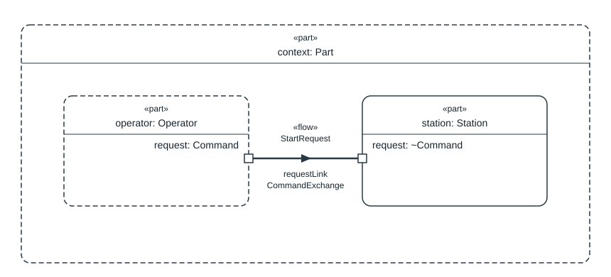

# Answer with SysML

**Explain the system. Keep the model.**

Give an agent your source documents and a question. It interprets the material, builds or updates a native SysML v2 model, and answers with an interactive HTML explanation grounded in both the source and the model. Keep the model behind the visuals so the work remains useful after the presentation is over.

Systems engineers need precision. Stakeholders need a clear story. Answer with SysML connects the two: selected views communicate the architecture, interfaces and behavior, while the underlying model preserves the elements and relationships those views describe.

```text
Source documents + question → Agent interpretation → Native SysML model
          ↑                                             │
          └──── Source changes / follow-up questions ← HTML + model views
```



[Build the example](examples/pump-station/README.md) · [Use the agent skill](SKILL.md)

## From documents to a grounded answer

The agent is the interpreter, not a text-to-diagram converter. It identifies source clauses, distinguishes facts from proposed design decisions, authors the model, and chooses views that answer your question. The bundled native engine checks the model; the reader binds its views to that exact revision.

A follow-up question can reuse the model. A changed source document calls for source-impact review, a model update, qualification and regenerated answers. Native source and evidence remain available instead of being discarded after making a picture.

**Start with:** “Read this concept of operations. Model the system, then explain who owns each decision and what must happen before release. Show the architecture and workflow, and link the answer to the source.”

[Reproduce a source-to-model-to-answer study](examples/source-to-answer/README.md). This is an agent-guided workflow: the CLI consumes an authored recipe, not arbitrary prose, and does not autonomously certify the interpretation.

## Review the interpretation, not just the syntax

Before delivery, the skill calls for a separate [source-interpretation review](references/source-interpretation-review.md): concurrency outcomes, acknowledgment versus completion, complete boundary messages, and changes across revisions. A hash-bound review receipt and regression tests help prevent recorded source expectations from being omitted or silently invalidated. They do not replace independent engineering judgment.

## Why this exists

A slide can explain an architecture but lose its model. A modeling environment can preserve the model but be difficult for a wider audience to use. This skill offers a practical middle ground:

- **Meet people in the browser.** Share a self-contained reader without asking every reviewer to install a modeling tool.
- **Explain one system in several ways.** Choose architecture, hierarchy, lifecycle, dataflow, interface diagrams or matrices according to the question.
- **Keep views connected.** Follow a selected component across views and inspect its source when more detail is needed.
- **Retain engineering work.** Deliver the native `.sysml` model and view recipes alongside the HTML rather than only a picture.
- **Make change repeatable.** Update the model, qualify the new revision and regenerate its views. Do not maintain disconnected drawings by hand.

The aim is to lower the barrier to understanding and adopting MBSE, not to hide the model or replace systems engineering judgment.

## Where it helps

| Situation | A useful explanation |
| --- | --- |
| Introduce a system concept | Show the boundary, major elements and their relationships. |
| Review an interface | Trace endpoints and item flows; use a matrix to examine coverage. |
| Discuss behavior | Present supported state or action views with readable conditions. |
| Bring a new colleague up to speed | Let them move between the system overview, detailed views and source. |
| Review an evolving design | Regenerate the reader from a new qualified model revision. |

## A model-backed answer, not a diagram-shaped answer

The model owns meaning. The renderer owns presentation.

The reader consumes source-bound semantic facts and view recipes. It does not infer system behavior from where boxes happen to sit, or treat an attractive diagram as proof that the model is correct. Relationships, direction and membership come from the selected model scope.

A typical delivery contains:

```text
system-reader/
├── index.html       # Self-contained interactive explanation
├── model.sysml      # Native model source
├── views.json       # Selected view recipes
├── reader.json      # Reader data and source-binding evidence
└── LICENSES.txt     # Included renderer notices
```

Readers can open `index.html` directly. Authors keep the model, recipes and qualification evidence for subsequent changes.

## Use with an agent

Start with [SKILL.md](SKILL.md). Give a skill-capable agent this repository and a concrete engineering question. Include source material, intended audience and the decisions the explanation should support.

For example:

> Explain a small pumping station to a mixed engineering and operations audience. Model its boundary, pumps, controller and interfaces in SysML v2. Create an overview, an interface view and a behavior view from the same model. Deliver an interactive HTML reader plus the editable model and view recipes. Keep proposed design choices distinct from established requirements.

Or, with an existing model:

> Use this model to explain how the controller communicates with the pumps. Keep element identity consistent between the architecture and interface views. Show only the scope needed for an interface review and retain the source for future updates.

The agent should select the smallest useful set of views, qualify the source and inspect the generated result. No particular hosted model provider is required by the rendering workflow.

## Authoring setup

The authoring workflow uses **Python 3.10+, Java 21+, Graphviz and Node.js**. The native SysML language runtime is pinned and installed into the package's own `.runtime` directory; it is not bundled in a source checkout.

The pinned runtime is `jupyter-sysml-kernel-0.52.0.zip` from the [official 2025-09 release](https://github.com/Systems-Modeling/SysML-v2-Pilot-Implementation/releases/tag/2025-09). See the [native package setup and runtime contract](.agent/skills/knowledge-engine/specialists/sysml-v2-modeling/PACKAGE.md) for dependency details. Install that archive locally, then check the package:

```sh
python3 .agent/skills/knowledge-engine/specialists/sysml-v2-modeling/scripts/sysml.py \
  setup --archive /path/to/official-kernel.zip

python3 .agent/skills/knowledge-engine/specialists/sysml-v2-modeling/scripts/sysml.py doctor
```

For a model with a matching successful managed qualification report and view recipes:

```sh
python3 scripts/archify.py sysml-reader \
  --source /path/to/model.sysml \
  --report /path/to/qualification/report.json \
  --views /path/to/views.json \
  --output /path/to/system-reader \
  --title "System overview"
```

Use a new output directory. When the model changes, regenerate its qualification report before exporting again. Mismatched or stale model/report combinations are rejected.

Read the [SysML reader guide](resources/tools/archify/SYSML.md) for the complete workflow and the [view map](resources/tools/archify/SYSML-VIEW-MAP.md) for implemented view families and boundaries.

## Scope

This is a bounded SysML v2 authoring and communication workflow, not a general-purpose modeling-tool replacement. Supported views depend on the qualified semantic profiles. Views are purpose-specific explanatory projections, not complete notation-preserving diagrams; inspect the native model for details not shown. A declared verification is not an executed test, and a rendered behavior view is not a simulation. The exported reader is read-only; model changes happen in the source and are qualified again.

Before sharing, review the exported model and reader data as well as the visible page: the deliverable intentionally retains engineering information.

## Built on established work

The package combines the maintained native SysML modeling specialist with the [Archify](https://github.com/tt-a1i/archify) rendering engine and model-to-view adapters. It retains their applicable licenses and third-party notices. See the [native specialist license](.agent/skills/knowledge-engine/specialists/sysml-v2-modeling/LICENSE), [Archify license](resources/tools/archify/upstream/LICENSE) and [renderer third-party notices](resources/tools/archify/upstream/THIRD_PARTY_NOTICES.md).

The central principle is simple: **make the explanation accessible without throwing away the engineering model.**
