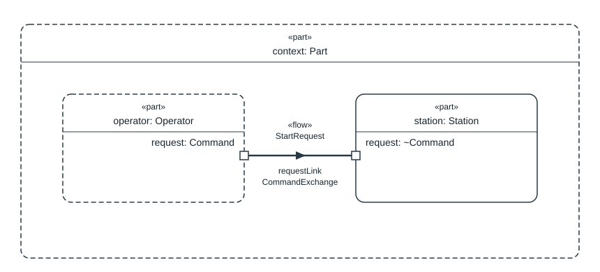

# Pump station

A fictional pump station demonstrates one model through architecture, hierarchy,
state, flow, port and matrix views. After building, open `output/pump-reader/index.html` in a browser.

From the repository root, after the runtime setup:

```sh
python3 .agent/skills/knowledge-engine/specialists/sysml-v2-modeling/scripts/sysml.py qualify \
  --source examples/pump-station/model.sysml \
  --views examples/pump-station/views.json \
  --output output/pump-qualification
python3 scripts/archify.py sysml-reader \
  --source examples/pump-station/model.sysml \
  --views examples/pump-station/views.json \
  --report output/pump-qualification/report.json \
  --output output/pump-reader --title "Pump station"
```

Use fresh output folders for each new revision.


